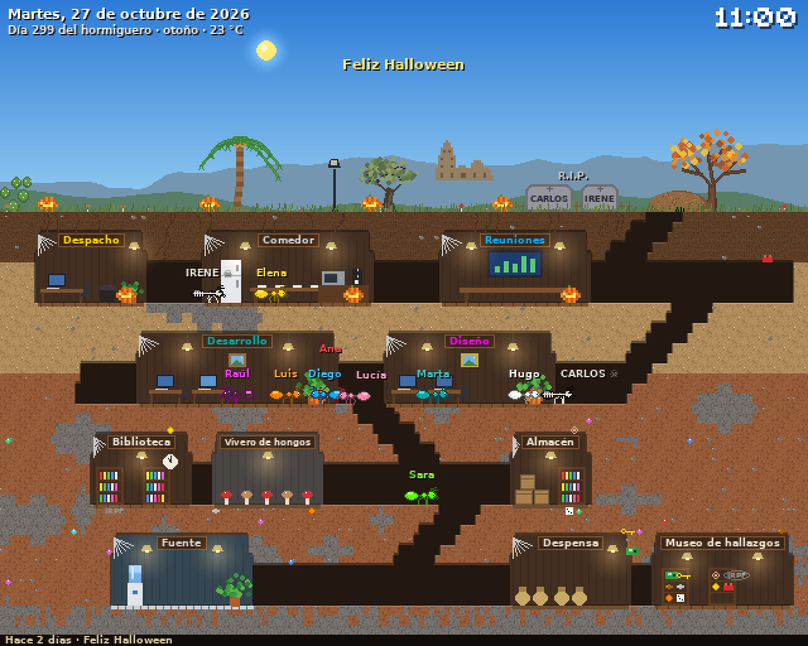
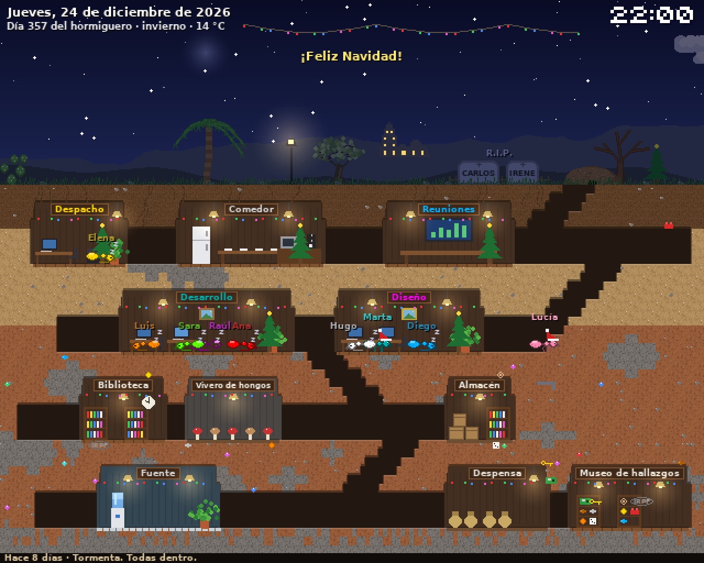
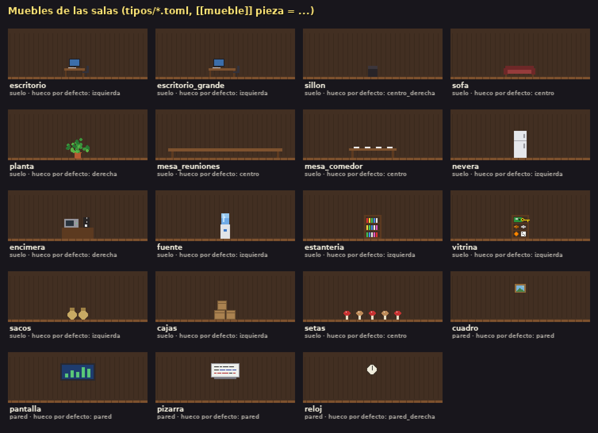
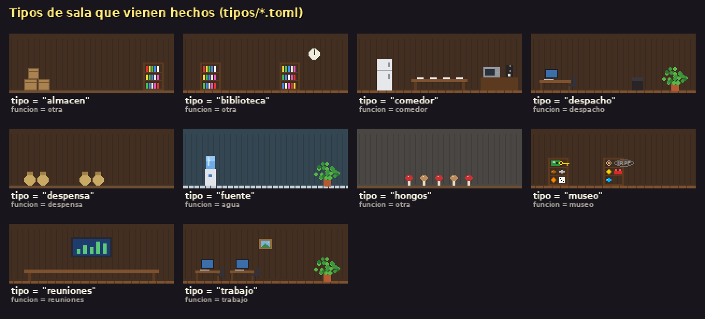
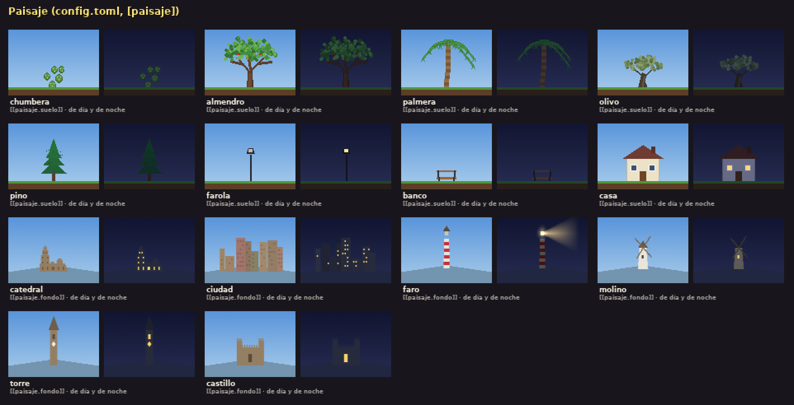

# Ant Farm Idle

Un hormiguero en pixel art para dejar puesto en una pantalla. Cada persona de tu
equipo, tu familia o tu grupo de amigos es una hormiga con su nombre: tiene su sala,
baja al comedor a desayunar y a comer, va a por agua, cava túneles, sale a buscar
comida, celebra su cumpleaños y vive las estaciones, el tiempo de tu ciudad y las
fiestas del año. El hormiguero crece solo durante todo el año.

*A pixel-art ant farm for an always-on screen: every person in your team, family or
group of friends is an ant with their name, their room and their birthday. It grows
by itself over the year, follows your city's real weather and celebrates holidays.
Configuration and code are in Spanish.*




## Probarlo

Hace falta Python 3.11 o más nuevo y pygame.

```bash
pip install pygame
python3 hormiguero_pixel.py --ventana
```

| Opción | |
|---|---|
| `--ventana` | En una ventana (si no, a pantalla completa). |
| `--demo` | Un año entero a toda velocidad, parando en las fechas importantes. |
| `--fecha 2026-12-24 --hora 21:00` | Ver un día y una hora concretos. |
| `--tiempo nieve` | Forzar el tiempo: `despejado`, `nublado`, `lluvia`, `tormenta`, `nieve` o `calima`. |
| `--captura imagen.png` | Sin pantalla: simula un rato y guarda una imagen. |
| `--medir` | Sin pantalla: mide lo que tarda cada fotograma. |

Teclas: `q` o `Esc` para salir, `f` pantalla completa, `i` fotogramas por segundo.

## Ponerlo a tu gusto

Todo se configura con ficheros de texto ([TOML](https://toml.io/es/)). Los cambios de
gente, reuniones, idas y fiestas se aplican solos a los pocos segundos de guardar; lo
demás (nombre, color, sitio, ancho, tipo y muebles de las salas, los tipos y
`config.toml`) al reiniciar. Los de este repositorio son de ejemplo: los tuyos pueden
ir en `local/`, fuera de git (mira [Tus datos](#tus-datos)).

Si algo está mal escrito (una fecha, un color, una sala demasiado estrecha...), el
hormiguero no se para: usa un valor por defecto y lo cuenta en una franja amarilla
arriba de la pantalla. Con `--captura`, los avisos salen en la terminal.

| Fichero | Qué hay |
|---|---|
| `salas/*.toml` | Una sala por fichero: su nombre, color, planta, tipo y la gente que trabaja en ella. |
| `tipos/*.toml` | Los tipos de sala: qué hacen allí las hormigas y qué muebles hay. Ver [tipos/LEEME.md](tipos/LEEME.md). |
| `idos.toml` | Los que se fueron: cada uno tiene su lápida en el cementerio y, el día en que se va, su despedida en el diario. |
| `calendario.toml` | Las fiestas y cómo se decora el hormiguero. En `ejemplos/` hay uno con las fiestas de Andalucía y de España. |
| `config.toml` | Nombre del grupo, fecha de fundación, ciudad, tiempo real, horarios, salas que se excavan durante el año y paisaje. |

### Salas y gente

```toml
nombre = "Desarrollo"
color = "cian"
planta = 2          # de 1 (la más alta) a 4 (la más honda)
x = 40              # opcional: columna fija; sin x va en un hueco al azar de su planta
ancho = 40          # en columnas (como mínimo 14)
tipo = "trabajo"    # trabajo, reuniones, despacho, comedor, fuente... (tipos/)

[[miembro]]
nombre = "Ana"
cumple = "14-03"    # día-mes: ese día lleva gorro de fiesta y hay tarta arriba
```

Los túneles y las rampas entre plantas se trazan solos, y las hormigas encuentran el
camino por ellos. Si una sala tiene `jefe = true`, quien esté en ella llama de vez en
cuando a alguien al despacho; las reuniones fijas se ponen con `[[reunion]]` (mira
`salas/reuniones.toml`). Cada hormiga va por su nombre: si dos personas se llaman igual,
la segunda sale con el de su sala («Ana (Diseño)»).

### Muebles

Cada tipo de sala lleva sus muebles en huecos fijos (`izquierda`, `centro`, `derecha`,
`pared`...), y una sala puede añadir más con sus propios `[[mueble]]`:

```toml
[[mueble]]
pieza = "sofa"
sitio = "centro_derecha"
```

Hay escritorios, mesas, nevera, cafetera, fuente de agua, estanterías, vitrina con los
hallazgos de la colonia, pizarra, un reloj que marca la hora de verdad, sofá, plantas
que crecen con los días... La lista completa está en [tipos/LEEME.md](tipos/LEEME.md).




Las salas que excavan durante el año (despensa, museo, vivero de hongos, almacén y
biblioteca, se pueden cambiar en `[nido]`) se ponen en los huecos libres. Si ya no
caben, abren una planta más honda con una rampa nueva o las hacen más estrechas; si
el hormiguero está lleno del todo, se quedan sin hacer y lo cuenta el diario.

### Paisaje

En `config.toml` se elige lo que hay arriba y dónde (en % del ancho de la pantalla):
árboles, chumberas, farolas, bancos y casas en la superficie; catedral, ciudad, faro,
molino, torre o castillo al fondo. De noche se encienden las ventanas y las farolas,
el faro barre el cielo y el molino gira.



```toml
[[paisaje.suelo]]
pieza = "pino"
x = 22

[[paisaje.fondo]]
pieza = "faro"
x = 45
```

### Tiempo real

Con `[ciudad]` (latitud y longitud) el sol sale y se pone a su hora. Si el ordenador no
está en la zona horaria de la ciudad, pon también `zona_horaria` (por ejemplo
`"Europe/Madrid"`): el reloj del hormiguero, los horarios y el sol irán en la hora de la
ciudad. Para que además llueva, nieve o haya tormenta cuando de verdad pasa en tu
ciudad, crea una clave gratuita en [OpenWeather](https://openweathermap.org/api) y
guárdala en `local/openweather_clave.txt` (la carpeta `local/` no se sube a git; mejor
no la pongas en `config.toml` si vas a subirlo a algún sitio):

```bash
mkdir -p local && echo tu_clave > local/openweather_clave.txt
```

Para probar en el ordenador también vale `export OPENWEATHER_API_KEY=tu_clave`, pero el
servicio de la Pi no ve las variables de tu sesión: allí usa el fichero, o pon la línea
`OPENWEATHER_API_KEY=tu_clave` en `local/entorno`, que el servicio lee al arrancar (si lo
instalaste antes de que existiera esta opción, vuelve a ejecutar `instalar-pi.sh`).
Sin clave, o si se va internet, el tiempo sale de un modelo estadístico.

Cuando nieva, la nieve se queda encima de los árboles, los tejados, las lápidas y el
suelo, y en las cumbres de los montes, hasta un día después.

### Halloween

Con `esqueletos = true` en `[halloween]`, del 26 al 31 de octubre los que se fueron
(`idos.toml`) salen del cementerio y se pasean por el hormiguero como hormigas
esqueleto, también de noche.

## Reinicios y apagones

La primera vez que arranca con la hora de verdad (no en `--demo`, ni con `--fecha`,
`--hora`, `--dias` o `--acelerar`, ni al hacer capturas con `--captura` o `--medir`)
crea `local/estado.json`, y en cada arranque lo vuelve a leer, así que reiniciar la Pi
o el servicio no cambia nada:

- **El color de cada hormiga** que no tiene uno fijo se elige una vez (el menos usado) y
  ya no cambia, aunque entre o se vaya gente.
- **Dónde estaba cada hormiga**: al volver, sigue en el mismo sitio.
- **La fecha de fundación y la semilla**, si no están en `config.toml`: la fundación es
  el día del primer arranque y la semilla se elige al azar una sola vez. Las pruebas
  usan las que haya guardadas; si aún no hay, unas de un solo uso que no se guardan.
- **Lo excavado.** Con `cavar = "encendido"` en `[nido]` (lo normal), las hormigas sólo
  cavan mientras el hormiguero está en marcha: una semana apagado es una semana sin
  obras. Con `cavar = "fecha"`, las obras avanzan con los días aunque esté apagado.

Lo excavado y dónde estaba cada hormiga se guardan aparte para cada hormiguero (cada
fundación y semilla): una prueba con otra semilla (`--semilla 7`) o con otra fundación
tiene lo suyo y no toca lo del hormiguero de verdad. Si `config.toml` tiene una errata y
no se puede leer, sigue con el último hormiguero que se guardó.

Se guarda cada minuto y al pararlo, así que para empezar un hormiguero de cero hay que
borrar `local/estado.json` con el hormiguero parado (si no, lo vuelve a escribir). En la Pi:

```bash
sudo systemctl stop hormiguero
rm ~/Ant-Farm-Idle/local/estado.json
sudo systemctl start hormiguero
```

## En una Raspberry Pi

Pensado para una Raspberry Pi 3 o más nueva con **Raspberry Pi OS Lite** (sin
escritorio, para que vaya lo más fluido posible) conectada a una pantalla.

1. Graba Raspberry Pi OS Lite con Raspberry Pi Imager (con WiFi, SSH y tu zona horaria).
2. Copia el repositorio a la Pi (por ejemplo, con `git clone` o `scp -r`).
3. En la Pi: `bash ~/Ant-Farm-Idle/instalar-pi.sh`

El instalador pone pygame y la fuente DejaVu, crea el servicio `hormiguero` (arranca al
encender y se relanza solo si se cierra) y evita que la pantalla se apague. Desde SSH:

```bash
sudo systemctl restart hormiguero     # relanzarlo
sudo systemctl stop hormiguero        # pararlo
journalctl -u hormiguero -f           # ver mensajes y errores
./en-pantalla.sh python3 hormiguero_fb.py --demo   # otra cosa en la pantalla (Ctrl+C: vuelve el hormiguero)
```

En la Pi el servicio usa `hormiguero_fb.py`, que pinta directamente en el framebuffer
(`/dev/fb0`): en una Pi 3 sin escritorio, pygame con aceleración gráfica deja la
pantalla en negro.

## Tus datos

Los ficheros de `salas/`, `idos.toml` y `calendario.toml` de este repositorio son de
ejemplo, con gente inventada. Para usar los tuyos sin subir nombres ni cumpleaños,
ponlos en la carpeta `local/`, que no se sube a git: si existen `local/config.toml`,
`local/salas/`, `local/tipos/`, `local/idos.toml` o `local/calendario.toml`, se usan en
lugar de los del repositorio sin poner ninguna opción, también en el servicio de la Pi.
Por ejemplo:

```bash
mkdir -p local
cp -r salas idos.toml calendario.toml config.toml local/
```

y edita las copias. Cada uno sustituye entero al del repositorio (si haces
`local/tipos/`, tiene que tener todos los tipos que uses). Después de crear uno nuevo en
`local/`, reinicia el hormiguero para que lo vea. También puedes guardarlos en otro sitio
y arrancar con `--salas`, `--tipos`, `--idos`, `--calendario` y `-c` apuntando a ellos.

## Galerías

Las imágenes de muebles, tipos de sala y paisaje de `docs/` se regeneran con
`python3 herramientas/galeria.py` (por ejemplo, después de añadir una pieza nueva). Usa
siempre los ficheros de ejemplo del repositorio (no los de `local/`) y no escribe en `local/`.

## Licencia

MIT. Ver [LICENSE](LICENSE).
